# Documentación Técnica del Proyecto - MiTutoría IUB (ConsultasIUB)

**Versión del Documento:** 2.0.0  
**Fecha:** Octubre 2026  
**Institución:** Institución Universitaria de Barranquilla (IUB) - Sede Plaza de la Paz  
**Tecnología Base:** Angular 22.2.0, TypeScript 6.0.2, Vite / Angular Build, Bootstrap Icons  

---

## 1. Visión General del Proyecto

**ConsultasIUB (MiTutoría - Sistema Académico IUB)** es una solución web empresarial desarrollada para digitalizar, centralizar y optimizar la gestión integral de tutorías académicas, monitorías estudiantiles y semilleros de investigación en la Institución Universitaria de Barranquilla.

### 1.1. Objetivos Estratégicos
- **Cero Papel:** Sustituir planillas físicas y formatos impresos por un flujo 100% digital con almacenamiento estructurado y trazabilidad en tiempo real.
- **Trazabilidad y Auditoría 24/7:** Registro cronológico de solicitudes, marcas de tiempo de atención, control booleano de asistencia (1/0) y compromisos académicos asumidos.
- **Equidad y Balance de Carga:** Identificación de asignaturas de alta demanda y reasignación ágil de casos para evitar represamiento en docentes titulares.
- **Acceso Multi-Rol:** Experiencia de usuario segmentada según el perfil: **Estudiante**, **Docente** y **Coordinación (Administrador)**.

### 1.2. Principios de Arquitectura Angular Moderna (v22+)
- **100% Standalone Components:** Se prescinde por completo de módulos (`NgModule`), facilitando la reutilización y reduciendo la complejidad del árbol de dependencias.
- **Reactividad con Signals:** Manejo de estado predecible y de alto rendimiento utilizando `@angular/core` (`signal`, `computed`, `asReadonly`).
- **Control Flow Sintaxis Nativo:** Empleo de `@for`, `@if` y `@empty` en lugar de directivas estructurales tradicionales (`*ngFor`, `*ngIf`).
- **Carga Diferida (Lazy Loading):** Todas las rutas de módulos cargan componentes dinámicamente mediante `loadComponent: () => import(...)`.
- **Inyección de Dependencias Moderna:** Inyección funcional mediante la función `inject()`.

---

## 2. Estructura de Directorios del Proyecto

El código fuente sigue una arquitectura orientada a características (**Feature-Driven Architecture**) complementada con una capa de componentes compartidos (**Shared Components**) y un núcleo de servicios transversales (**Core**):

```
ConsultasIUB/
├── public/                                # Recursos estáticos públicos (favicons, logos)
├── src/
│   ├── app/
│   │   ├── core/                          # Núcleo de la aplicación
│   │   │   ├── guards/                    # Guardianes de ruta (roleGuard, authGuard)
│   │   │   └── services/                  # Servicios transversales (@Injectable root)
│   │   │       ├── auth.ts                # Servicio de autenticación y roles
│   │   │       ├── data.ts                # Catálogo de datos y asignaturas
│   │   │       └── espacios-aux.ts        # Soporte para espacios y aulas
│   │   ├── layouts/                       # Layouts contenedores
│   │   │   ├── auth-layout/               # Layout para vistas de autenticación
│   │   │   └── main-layout/               # Layout principal con Sidebar, Header y Footer
│   │   │       ├── main-layout.ts
│   │   │       ├── main-layout.html
│   │   │       └── main-layout.css
│   │   ├── features/                      # Módulos funcionales de la aplicación
│   │   │   ├── administrador/             # Módulo de Coordinación / Admin
│   │   │   │   ├── dashboard-reportes/    # KPIs, estadísticas y exportación PDF
│   │   │   │   ├── gestion-usuarios/      # Directorio y administración de usuarios
│   │   │   │   ├── reasignacion-consultas/# Balanceo de carga y reasignación
│   │   │   │   └── gestion-cursos-roles/  # Mapeo de cursos, cupos y titulares
│   │   │   ├── docente/                   # Módulo de Docentes / Tutores
│   │   │   │   ├── bandeja-asignadas/     # Solicitudes recibidas y pendientes
│   │   │   │   ├── atencion-consulta/     # Formulario de atención y asistencia
│   │   │   │   ├── historial-tutorias/    # Registro histórico de sesiones
│   │   │   │   └── metricas-curso/        # Métricas individuales de atención
│   │   │   ├── estudiante/                # Módulo de Estudiantes
│   │   │   │   ├── mis-solicitudes/       # Seguimiento de solicitudes propias
│   │   │   │   ├── crear-consulta/        # Radicación de nueva consulta académica
│   │   │   │   ├── detalle-interaccion/   # Trazabilidad y respuesta del tutor
│   │   │   │   └── directorio-tutorias/   # Catálogo de tutores y horarios
│   │   │   ├── auth/                      # Flujos de acceso público
│   │   │   │   ├── login/                 # Inicio de sesión con selector demo
│   │   │   │   ├── registro/              # Formulario de registro institucional
│   │   │   │   └── recuperar-password/    # Restablecimiento de credenciales
│   │   │   └── principal/                 # Landing Page institucional
│   │   │       └── page/principal-page/   # Página de inicio con accesos rápidos
│   │   ├── shared/                        # Componentes reutilizables transversales
│   │   │   └── components/
│   │   │       ├── header/                # Encabezado institucional unificado
│   │   │       ├── footer/                # Pie de página institucional unificado
│   │   │       ├── nav/                   # Barra de navegación pública horizontal
│   │   │       ├── navbar/                # Barra superior independiente
│   │   │       ├── sidebar/               # Barra lateral reutilizable
│   │   │       ├── page-header/           # Cabecera interna para vistas y módulos
│   │   │       ├── kpi-card/              # Tarjetas de indicadores numéricos
│   │   │       ├── status-badge/          # Insignias de estado (Pendiente, etc.)
│   │   │       ├── priority-badge/        # Insignias de prioridad (Alta, Media)
│   │   │       ├── filter-bar/            # Barra de búsqueda y filtrado
│   │   │       ├── ai-insight-card/       # Tarjetas de sugerencias analíticas
│   │   │       ├── confirm-modal/         # Modal de confirmación de acciones
│   │   │       └── ticket-timeline/       # Línea de tiempo de estados
│   │   ├── app.config.ts                  # Configuración de proveedores y router
│   │   ├── app.routes.ts                  # Árbol de enrutamiento principal
│   │   ├── app.ts                         # Componente raíz
│   │   └── app.html                       # Router outlet base
│   ├── index.html                         # Plantilla HTML con Bootstrap Icons y fuentes
│   ├── main.ts                            # Bootstrap del runtime de Angular
│   └── styles.css                         # Estilos y variables globales
├── angular.json                           # Configuración del CLI de Angular
├── package.json                           # Manifiesto de dependencias y scripts
└── tsconfig.json                          # Configuración del compilador TypeScript
```

---

## 3. Diagrama de Arquitectura de la Solución

```mermaid
graph TD
    Root[App Component / Root Router Outlet]
    
    %% Vistas Públicas
    subgraph PublicViews["Vistas Públicas y Autenticación"]
        Principal[PrincipalPage - Landing]
        Login[Login - Selector de Roles Demo]
        Registro[Registro Institucional]
    end

    %% Layout Principal
    subgraph LayoutContenedor["MainLayout (Layout Unificado)"]
        Sidebar[Sidebar Dinámico por Rol]
        SharedHeader[Header Institucional / Dashboard Topbar]
        OutletContent[Router Outlet de Módulos]
        SharedFooter[Footer Institucional / Compacto]
    end

    %% Módulos del Sistema
    subgraph AdminModule["Módulo Administrador / Coordinación"]
        AdminReportes[Dashboard Reportes]
        AdminUsuarios[Gestión de Usuarios]
        AdminConsultas[Reasignación de Consultas]
        AdminCursos[Gestión Cursos y Roles]
    end

    subgraph DocenteModule["Módulo Docente / Tutor"]
        DocAsignadas[Bandeja Asignadas]
        DocAtencion[Atención de Consulta]
        DocHistorial[Historial de Tutorías]
    end

    subgraph EstudianteModule["Módulo Estudiante"]
        EstSolicitudes[Mis Solicitudes]
        EstCrear[Crear Consulta]
        EstDetalle[Detalle Interacción]
        EstDirectorio[Directorio Tutorías]
    end

    %% Enlaces de Navegación
    Root --> Principal
    Root --> Login
    Root --> Registro
    Root --> LayoutContenedor

    LayoutContenedor --> SharedHeader
    LayoutContenedor --> Sidebar
    LayoutContenedor --> OutletContent
    OutletContent --> SharedFooter

    OutletContent --> AdminReportes
    OutletContent --> AdminUsuarios
    OutletContent --> AdminConsultas
    OutletContent --> AdminCursos

    OutletContent --> DocAsignadas
    OutletContent --> DocAtencion
    OutletContent --> DocHistorial

    OutletContent --> EstSolicitudes
    OutletContent --> EstCrear
    OutletContent --> EstDetalle
    OutletContent --> EstDirectorio

    Principal --> SharedHeader
    Principal --> SharedFooter
    Login --> SharedHeader
    Login --> SharedFooter
    Registro --> SharedHeader
    Registro --> SharedFooter
```



---

## 4. Componentes Compartidos (Shared Components)

Los componentes compartidos se encuentran ubicados en `src/app/shared/components/`. A continuación se detalla su comportamiento, especificación técnica y cómo garantizan la uniformidad visual en toda la aplicación:

### 4.1. Header (`Header` - `src/app/shared/components/header`)
- **Selector:** `app-header`
- **Modo:** Standalone Component
- **Propiedades `@Input()`:**
  - `titulo: string` (Valor por defecto: `'MiTutoría IUB'`): Título principal mostrado en la cabecera.
  - `subtitulo: string` (Valor por defecto: `'Portal Institucional de Gestión y Acompañamiento Académico'`): Texto complementario.
  - `rol: string` (Opcional): Si se define, renderiza una píldora con indicador visual de estado y pulso verde (`ROL: DOCENTE`, `ROL: ADMIN`, etc.).
  - `variante: 'institucional' | 'dashboard' | 'compacto'` (Valor por defecto: `'institucional'`):
    - `'institucional'`: Fondo con degradado azul oscuro corporativo, escudo IUB, textos claros y sombra profunda. Utilizado en la página de inicio, login y registro.
    - `'dashboard'`: Fondo blanco limpio con borde inferior suave, ideal para paneles de control dentro del contenedor de trabajo.
    - `'compacto'`: Versión reducida en altura para interfaces con alta densidad de datos.
  - `mostrarLogo: boolean` (Valor por defecto: `true`): Permite ocultar el emblema gráfico en contextos que lo requieran.
- **Proyección de Contenido (`<ng-content>`):**
  - Permite inyectar controles personalizados a la derecha de la cabecera, tales como el selector de rol en vivo, el avatar de perfil o botones de acción rápida.

### 4.2. Footer (`Footer` - `src/app/shared/components/footer`)
- **Selector:** `app-footer`
- **Modo:** Standalone Component
- **Propiedades `@Input()`:**
  - `variante: 'completo' | 'compacto'` (Valor por defecto: `'completo'`):
    - `'completo'`: Diseño institucional en 3 columnas:
      1. **Columna Identidad:** Emblema IUB, descripción del sistema MiTutoría y sellos de calidad (*Vigilada Mineducación*, *Cero Papel*).
      2. **Columna Enlaces:** Accesos directos a Inicio, Portal de Acceso, Registro, Directorio de Tutorías y Reportes.
      3. **Columna Soporte y Contacto:** Dirección de la Sede Plaza de la Paz (Cra. 45 # 48-31, Barranquilla), correo de soporte y PBX institucional (+57 605 385 5050).
      - **Barra de Cierre:** Copyright dinámico con año actual, etiqueta de versión (`v2.0.0`), indicador de auditoría activa y estado operativo del sistema.
    - `'compacto'`: Barra limpia y estilizada integrada al final del área de contenido del layout principal, mostrando derechos reservados, versión de la plataforma y estado de auditoría.
- **Correcciones de Calidad Realizadas:**
  - Se eliminó el texto residual `footer works!` presente en versiones previas.
  - Se implementó navegación nativa con `RouterLink` para evitar recargas completas del navegador.

### 4.3. Estrategia de Aplicación a Todos los Módulos
Para garantizar que **todos los módulos** incorporen el encabezado y el pie de página de forma consistente, se establecieron dos mecanismos complementarios:
1. **Módulos Privados por Rol (Admin, Docente, Estudiante):**
   - Se aplican a nivel de `MainLayout` (`src/app/layouts/main-layout/`). Al posicionar `<app-header>` en la parte superior del contenedor y `<app-footer>` al pie del área de contenido (`.content-area`), cualquier componente hijo inyectado vía `<router-outlet>` dispone automáticamente de ambos componentes.
2. **Módulos Públicos y de Autenticación (Landing, Login, Registro):**
   - `PrincipalPage` incluye `<app-header>` en la cabecera y `<app-footer variante="completo">` al final de la página.
   - `Login` y `Registro` integran `<app-header>` y `<app-footer variante="completo">`, unificando toda la experiencia de usuario desde el ingreso hasta la navegación interna.

### 4.4. Otros Componentes Compartidos
- **Nav (`Nav`):** Barra de navegación horizontal pública con enlaces actualizados a las rutas operativas (`/principal`, `/estudiante/mis-solicitudes`, `/docente/asignadas`, `/admin/reportes`, `/estudiante/directorio-tutorias`, `/login`).
- **Navbar (`Navbar`):** Barra superior independiente con logo, enlaces y botón de acceso institucional.
- **Sidebar (`Sidebar`):** Menú lateral configurable con proyección de enlaces y botón de cierre de sesión.
- **PageHeader (`PageHeader`):** Cabecera interna para vistas con soporte para badge de sección, título, subtítulo y slot para botones primarios.

---

## 5. Detalle de Módulos Funcionales

### 5.1. Módulo Administrador (`/admin/*`)
Diseñado para la Coordinación Académica con el fin de supervisar la operación del sistema, gestionar accesos y balancear cargas docentes.

1. **Dashboard de Reportes (`/admin/reportes`):**
   - **Componente:** `DashboardReportes`
   - **Funcionalidad:** Métricas de efectividad global (Total de solicitudes, porcentaje de atención, pendientes y solicitudes vencidas). Tabla de demanda por asignatura con alertas de alta demanda y botón para exportar a PDF.
2. **Gestión de Usuarios (`/admin/usuarios`):**
   - **Componente:** `GestionUsuarios`
   - **Funcionalidad:** Buscador en vivo por nombre o correo, filtro por rol (ADMIN, DOCENTE, ESTUDIANTE), visualización de estados (*Activo/Inactivo*) y botón para creación de usuarios.
3. **Reasignación de Consultas (`/admin/consultas`):**
   - **Componente:** `ReasignacionConsultas`
   - **Funcionalidad:** Monitoreo de consultas represadas o con docentes sobrecargados; permite transferir la tutoría a otro docente disponible.
4. **Gestión de Cursos y Roles (`/admin/cursos-roles`):**
   - **Componente:** `GestionCursosRoles`
   - **Funcionalidad:** Configuración de asignaturas académicas, definición de cupos y asignación de profesores titulares.

---

### 5.2. Módulo Docente (`/docente/*`)
Orientado a los profesores titulares, tutores y monitores académicos para atender a los estudiantes y registrar evidencias.

1. **Bandeja de Tutorías Asignadas (`/docente/asignadas`):**
   - **Componente:** `BandejaAsignadas`
   - **Funcionalidad:** Listado cronológico de solicitudes asignadas con código estudiantil, asignatura, tema puntual y estado de atención. Botón de acceso directo a la atención de cada caso.
2. **Atención de Consulta Académica (`/docente/atencion`):**
   - **Componente:** `AtencionConsulta`
   - **Funcionalidad:** Formulario interactivo que digitaliza la sesión de tutoría (Cero Papel):
     - Datos informativos del estudiante.
     - Selección del tipo de atención (Individual, Grupal, Semillero, Refuerzo).
     - Temática abordada y campo extenso de compromisos y observaciones.
     - Casilla de verificación de asistencia con registro de auditoría (1/0 y marca de tiempo).
3. **Historial de Tutorías (`/docente/historial`):**
   - **Componente:** `HistorialTutorias`
   - **Funcionalidad:** Repositorio de consultas atendidas previamente con filtros de fecha y materia.
4. **Métricas de Curso (`/docente/metricas-curso`):**
   - **Componente:** `MetricasCurso`
   - **Funcionalidad:** Estadísticas de desempeño docente y volumen de estudiantes atendidos.

---

### 5.3. Módulo Estudiante (`/estudiante/*`)
Canal de autoservicio para los estudiantes de la IUB.

1. **Mis Solicitudes (`/estudiante/mis-solicitudes`):**
   - **Componente:** `MisSolicitudes`
   - **Funcionalidad:** Historial completo de consultas radicadas con tutor asignado, horario/franja y estado (*Programada*, *Pendiente*, *Completada*). Botón para radicar nueva consulta.
2. **Crear Consulta Académica (`/estudiante/crear`):**
   - **Componente:** `CrearConsulta`
   - **Funcionalidad:** Formulario estructurado para solicitar una tutoría:
     - Selección de asignatura y docente de preferencia (o asignación automática).
     - Modalidad (Presencial en Sede Plaza de la Paz o Virtual vía Meet/Teams).
     - Franja horaria sugerida (Mañana, Tarde, Noche).
     - Tema concreto y descripción detallada de la duda académica.
3. **Detalle de Interacción (`/estudiante/detalle`):**
   - **Componente:** `DetalleInteraccion`
   - **Funcionalidad:** Visualización de la respuesta emitida por el docente, material adjunto y compromisos concertados.
4. **Directorio de Tutorías y Monitores (`/estudiante/directorio-tutorias`):**
   - **Componente:** `DirectorioTutorias`
   - **Funcionalidad:** Catálogo público de profesores y monitores, sus áreas de conocimiento, horarios de atención y salas asignadas, con botón de solicitud directa.

---

### 5.4. Módulo de Autenticación y Acceso (`/auth`)

1. **Iniciar Sesión (`/login`):**
   - **Componente:** `Login`
   - **Funcionalidad:**
     - Identidad corporativa IUB con banner descriptivo de los pilares del proyecto (Cero Papel, Auditoría, Analítica).
     - **Selector de Rol para Evaluación:** Permite al evaluador seleccionar entre `ADMIN`, `DOCENTE` y `ESTUDIANTE`, precargando automáticamente las credenciales institucionales de prueba correspondientes.
     - Almacenamiento de sesión en `localStorage` y redirección inmediata a la ruta de inicio del rol correspondiente.
2. **Registro de Usuarios (`/registro`):**
   - **Componente:** `Registro`
   - **Funcionalidad:**
     - Formulario con validación en tiempo real para captura de: Nombre Completo, Tipo de Documento, Programa Académico, Rol Institucional (Estudiante, Docente, Egresado), Correo Institucional (`@unibarranquilla.edu.co`) y confirmación de contraseñas.
     - **Modal de Pre-Registro Institucional:** Al enviar el formulario, valida los datos requeridos y abre un modal interactivo con el resumen de la cuenta creada, notificando el estado pre-aprobado y ofreciendo opciones directas para modificar datos o avanzar al inicio de sesión (`/login`).
3. **Recuperar Contraseña:**
   - **Componente:** Modal integrado en `Login`
   - **Funcionalidad:** Enlace interactivo "¿Olvidaste tu contraseña?" que despliega una ventana modal para ingresar el correo institucional y simular el envío del enlace de restablecimiento seguro con retroalimentación visual inmediata.

---

### 5.5. Módulo Principal (`/principal`)
- **Componente:** `PrincipalPage`
- **Funcionalidad:** Portal de bienvenida oficial con encabezado institucional, barra de navegación rápida, presentación de los beneficios institucionales y tarjetas de acceso directo clasificadas por rol (Estudiantes, Docentes, Coordinación).

---

## 6. Matriz de Enrutamiento del Sistema

A continuación se detalla la configuración de rutas definida en `src/app/app.routes.ts`:

| Ruta | Componente Cargado (Lazy) | Layout Contenedor | Acceso / Rol | Descripción |
| :--- | :--- | :--- | :--- | :--- |
| `""` | Redirección a `/login` | - | Público | Redirección inicial por defecto |
| `"/principal"` | `PrincipalPage` | Independiente | Público | Landing page institucional con Header y Footer completos |
| `"/login"` | `Login` | Independiente | Público | Acceso al sistema, selector de roles de prueba y modal de recuperación |
| `"/registro"` | `Registro` | Independiente | Público | Formulario de registro con modal de pre-radicación |
| `"/admin/reportes"` | `DashboardReportes` | `MainLayout` | ADMIN | Dashboard de estadísticas y modal de exportación PDF |
| `"/admin/usuarios"` | `GestionUsuarios` | `MainLayout` | ADMIN | Administración de usuarios con modales de creación y edición |
| `"/admin/consultas"` | `ReasignacionConsultas` | `MainLayout` | ADMIN | Balanceo de carga y reasignación en tiempo real |
| `"/admin/cursos-roles"` | `GestionCursosRoles` | `MainLayout` | ADMIN | Cursos, asignación de docentes y modal de reasignación |
| `"/admin"` | Redirección a `/admin/reportes` | `MainLayout` | ADMIN | Ruta por defecto del administrador |
| `"/docente/asignadas"` | `BandejaAsignadas` | `MainLayout` | DOCENTE | Bandeja de solicitudes asignadas con navegación a atención |
| `"/docente/atencion"` | `AtencionConsulta` | `MainLayout` | DOCENTE | Formulario digital de sesión y modal de auditoría Cero Papel |
| `"/docente/historial"` | `HistorialTutorias` | `MainLayout` | DOCENTE | Historial filtrable y modal de visualización del formato F-IUB-04 |
| `"/docente"` | Redirección a `/docente/asignadas` | `MainLayout` | DOCENTE | Ruta por defecto del docente |
| `"/estudiante/mis-solicitudes"` | `MisSolicitudes` | `MainLayout` | ESTUDIANTE | Lista reactiva, modal de consulta rápida y modal de ficha detallada |
| `"/estudiante/crear"` | `CrearConsulta` | `MainLayout` | ESTUDIANTE | Formulario de radicación y modal de confirmación con radicado |
| `"/estudiante/detalle"` | `DetalleInteraccion` | `MainLayout` | ESTUDIANTE | Trazabilidad de sesión y modal de constancia oficial de asistencia |
| `"/estudiante/directorio-tutorias"` | `DirectorioTutorias` | `MainLayout` | ESTUDIANTE | Buscador reactivo y modal de agendamiento de cita previa |
| `"/estudiante"` | Redirección a `/estudiante/mis-solicitudes` | `MainLayout` | ESTUDIANTE | Ruta por defecto del estudiante |
| `"**"` | Redirección a `/login` | - | Público | Comodín para rutas no existentes |

---

## 7. Capa de Servicios del Núcleo (`src/app/core`)

Los servicios del núcleo fueron estandarizados utilizando la inyección de dependencias moderna de Angular:

1. **`Auth` (`src/app/core/services/auth.ts`):**
   - Configurado con `@Injectable({ providedIn: 'root' })`.
   - Administra el estado de autenticación, el rol activo y el almacenamiento local.
2. **`Data` (`src/app/core/services/data.ts`):**
   - Configurado con `@Injectable({ providedIn: 'root' })`.
   - Provee los catálogos de asignaturas (Estructura de Datos, Bases de Datos, Programación Web), modalidades y franjas horarias.
3. **`EspaciosAux` (`src/app/core/services/espacios-aux.ts`):**
   - Configurado con `@Injectable({ providedIn: 'root' })`.
   - Gestiona la información física y virtual de atención (Salas en Sede Plaza de la Paz, enlaces de Google Meet).

---

## 8. Sistema de Diseño y Paleta de Colores

La aplicación utiliza la identidad institucional de la **Institución Universitaria de Barranquilla (IUB)**:

| Nombre del Token | Código HEX / Valor | Aplicación |
| :--- | :--- | :--- |
| **IUB Dark Navy** | `#071936` / `#0b2247` | Fondos de Header, Sidebar, login banner y pie de página |
| **IUB Deep Blue** | `#0f2c59` / `#16437e` | Degradados intermedios y contenedores oscuros |
| **IUB Royal Blue** | `#1e56a0` / `#2563eb` | Botones de acción principal, enlaces activos y badges |
| **IUB Sky Blue** | `#38bdf8` / `#7dd3fc` | Acentos visuales, iconos destacados y bordes brillantes |
| **Light Slate** | `#f1f5f9` / `#f8fafc` | Fondo de página de las vistas internas y tarjetas neutras |
| **Surface White** | `#ffffff` | Tarjetas de contenido principal, modales y formularios |
| **Success Green** | `#22c55e` / `#dcfce7` | Estado "Completada" / "Al día" y control de asistencia |
| **Warning Amber** | `#f59e0b` / `#fef3c7` | Estado "Pendiente" y avisos de alta demanda |
| **Danger Red** | `#ef4444` / `#fee2e2` | Solicitudes vencidas, acciones destructivas y cerrar sesión |

---

## 9. Guía de Ejecución y Pruebas

### 9.1. Instalación de Paquetes
```bash
npm install
```

### 9.2. Modo Desarrollo
```bash
npm start
# O alternativamente:
ng serve
```
Disponible en `http://localhost:4200/`.

### 9.3. Compilación de Producción
```bash
npm run build
```
Genera los archivos optimizados en `dist/Consultas-iub`.

### 9.4. Pruebas Unitarias
```bash
npm test
```
Ejecuta las pruebas mediante Vitest.

---

## 10. Bitácora de Refactorizaciones y Mejoras Realizadas

1. **Unificación de Encabezado y Pie de Página en Todos los Módulos:**
   - Se rediseñó el componente `Header` (`<app-header>`) con soporte para variantes (`institucional`, `dashboard`, `compacto`), badge de rol activo y proyección de controles mediante `<ng-content>`.
   - Se rediseñó el componente `Footer` (`<app-footer>`) con estructura institucional completa (identidad, enlaces rápidos, contacto de la sede Plaza de la Paz) y variante compacta para dashboards.
   - Se eliminaron textos provisionales como `footer works!` y `Mi Primera app en angular`.
   - Se integraron `Header` y `Footer` en `MainLayout`, cubriendo instantáneamente todas las vistas hijas de los módulos Administrador, Docente y Estudiante.
   - Se aplicaron igualmente en las vistas públicas `PrincipalPage`, `Login` y `Registro`.
2. **Activación de Funcionalidades Interactivas y Formularios en Todos los Módulos:**
   - **Registro de Usuario (`Registro`):** Formulario institucional completo con validación y apertura de modal con opciones de pre-registro y redirección a login.
   - **Login (`Login`):** Botón "¿Olvidaste tu contraseña?" activo con modal de recuperación institucional y confirmación.
   - **Mis Solicitudes (`MisSolicitudes`):** Botón "+ Nueva Consulta" que abre modal rápido con opción a formulario completo; botones "Ver Detalle" que abren la ficha de radicación institucional.
   - **Crear Consulta (`CrearConsulta`):** Botón "Enviar Solicitud" con validación y modal de confirmación con radicado `#TUT-2026-X`; botón "Cancelar" con navegación segura.
   - **Directorio de Tutorías (`DirectorioTutorias`):** Buscador reactivo en tiempo real y botones "Solicitar Cita" con modal de agendamiento y reserva.
   - **Detalle de Interacción (`DetalleInteraccion`):** Botón "Volver a Mis Solicitudes" activo y botón "Descargar Constancia" con modal de certificación F-IUB-04.
   - **Atención de Consulta (`AtencionConsulta`):** Botón "Finalizar y Registrar Tutoría" con modal de radicación de auditoría y folio.
   - **Historial de Tutorías (`HistorialTutorias`):** Buscador y selector de asignatura reactivos, y botones "Ver Formato" con modal de inspección del acta institucional.
   - **Gestión de Usuarios (`GestionUsuarios`):** Modales funcionales para "+ Nuevo Usuario" y "Editar Usuario", además de filtros reactivos por rol y búsqueda.
   - **Gestión Cursos y Roles (`GestionCursosRoles`):** Formulario de creación de cursos y modal de reasignación de docente titular.
   - **Dashboard Reportes (`DashboardReportes`):** Botón "Exportar PDF" con modal de configuración y descarga simulada.
3. **Corrección de Decoradores en Capa Core:**
   - Se sustituyeron las declaraciones inválidas `@Service()` en `auth.ts`, `data.ts` y `espacios-aux.ts` por el estándar Angular `@Injectable({ providedIn: 'root' })`.
4. **Actualización de Enlaces en Navegación (`Nav` y `Navbar`):**
   - Se reemplazaron rutas desactualizadas por las rutas reales del árbol de enrutamiento modular.
5. **Integración de Iconografía y Tipografía:**
   - Se incorporó la librería **Bootstrap Icons** en `index.html` para asegurar el renderizado de iconos en el login, registro y tablas administrativas.
6. **Resolución de Conflictos de Versión y Compilación Cero Errores:**
   - Limpieza de marcadores de conflicto de Git en `README.md`.
   - Compilación verificada con `npm run build` en 0 errores y 0 advertencias.

---

© 2026 **Institución Universitaria de Barranquilla (IUB)**. Cra. 45 # 48-31, Barranquilla, Atlántico, Colombia.

